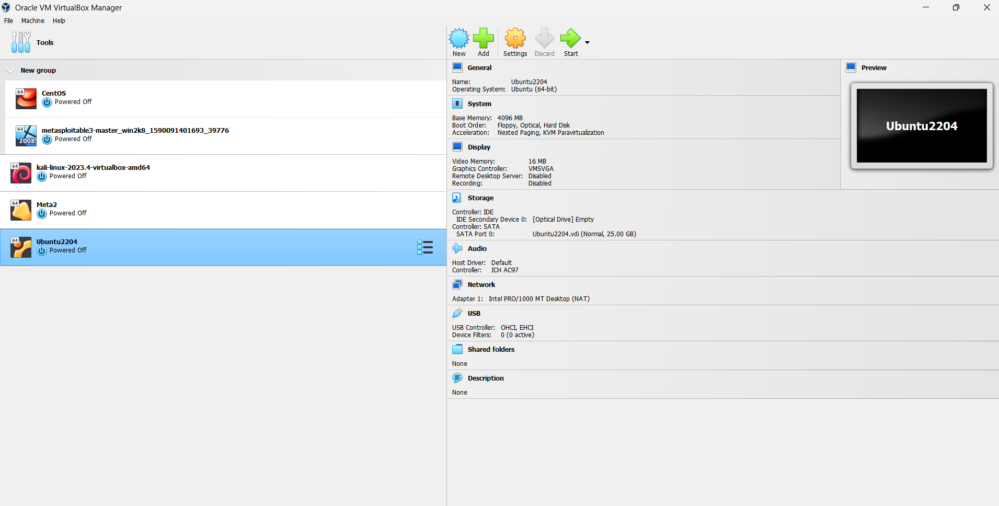

# Ubuntu 22.04 VirtualBox Home Lab

## Objective

The purpose of this lab was to build and configure an Ubuntu Linux virtual machine using Oracle VirtualBox for hands-on Linux administration, IT support, and cybersecurity practice.

## Lab Environment

- Host Operating System: Windows
- Virtualization Platform: Oracle VM VirtualBox
- Guest Operating System: Ubuntu 22.04 LTS 64-bit
- Memory: 4 GB RAM
- Virtual Disk: 25 GB VDI
- Network Adapter: NAT
- Graphics Controller: VMSVGA

## Tasks Completed

- Created an Ubuntu 22.04 virtual machine in Oracle VirtualBox
- Configured virtual memory and storage
- Installed Ubuntu Desktop
- Configured NAT networking
- Verified successful Ubuntu installation and startup
- Expanded the Linux LVM storage
- Prepared the system for future Linux administration labs

## Skills Demonstrated

- Oracle VirtualBox
- Virtual Machine Configuration
- Ubuntu Linux
- Linux Installation
- LVM Storage Management
- Virtual Networking
- System Administration
- IT Troubleshooting

## Screenshot

## Next Steps

Future labs will include:

- Linux command-line administration
- User and group management
- File and directory permissions
- Package management
- Linux networking commands
- SSH configuration
- System monitoring
- Linux security configuration
